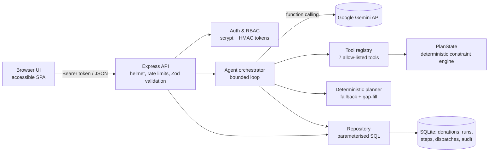

# RescueRoute: agentic food-rescue dispatch

> An AI agent that routes surplus food from restaurants, hostels and events to NGOs **before it expires**. Every constraint is verified in code, and a human approves every dispatch.

**Domains:** Sustainability · Food · Open innovation
**Stack:** Node.js 24 · Express 5 · SQLite (built-in `node:sqlite`) · Google **Gemini API** (function calling, automatic model failover) · vanilla HTML/CSS/JS (no build step)

### At a glance (all figures measured locally on 23 Oct 2026; reproduce with the commands shown)

| Area | Evidence | Reproduce |
|---|---|---|
| **Problem alignment** | Bounded agent workflow: analyze → assess → Gemini plan (tool calls) → fallback → verify → save → evaluate → summarize, with human approval | `npm run check:gemini` |
| **Testing** | 55 automated tests (unit, API integration, agent failure paths, security, accessibility); **97.2% line / 87.9% branch coverage** | `npm run test:coverage` |
| **Security** | Threat model in [SECURITY.md](SECURITY.md); RBAC, IDOR protection, CSP, rate limits, prompt-injection containment, audit log; **0 production vulnerabilities** | `npm run audit` |
| **Code quality** | ESLint (recommended rules plus an `innerHTML` ban), layered modules, dependency injection, one Zod schema for validation and the Gemini tool declarations, CI on every push | `npm run lint` |
| **Efficiency** | Deterministic planner p50 0.74 ms per scenario; batched Gemini tool calls; 5 runtime dependencies; no frontend build | `npm run evaluate` |
| **Impact** | +67.5% food delivered safely vs first-come-first-served dispatch on 200 synthetic scenarios, with 0 vs 1,558 unsafe dispatches | `npm run evaluate` |
| **Accessibility** | Skip link, landmarks, labelled controls, live regions, table captions, focus styles, reduced motion, dark mode; checked by automated tests | `tests/accessibility.test.js` |

**Contents:** [Problem](#1-the-problem) · [Solution](#2-what-rescueroute-does) · [Architecture](#3-architecture) · [Google tech](#4-google-technology) · [Security](#5-security) · [Results](#6-measured-results) · [Tests](#7-tests) · [Run locally](#8-run-it-locally) · [Deploy](#9-deploy) · [API](#10-api) · [Disclosure](#11-disclosure)

---

## 1. The problem

India wastes tens of millions of tonnes of food a year, while food-rescue NGOs run dispatch over WhatsApp groups and spreadsheets. A coordinator has minutes to answer questions like these:

- Which shelter is still open and has space for 90 kg of cooked food?
- Does the milk need a refrigerated van, and is one free?
- Will the e-rickshaw reach Hadapsar before the biryani becomes unsafe?

Done by hand on a first-come-first-served basis, perishable food is sent to the wrong place or arrives too late. Some of these constraints are hard: expiry, cold chain, vehicle capacity, NGO capacity and closing time. Others are soft: urgency, distance, keeping big NGOs free for big loads. Together they make this a real planning problem, not a chat problem.

## 2. What RescueRoute does

1. Coordinators log surplus donations (category, kg, cold-chain need, expiry).
2. A coordinator clicks **Run agent** with an objective, such as "prioritise cooked meals and keep distance low".
3. The **Gemini agent** reads the situation through tools, ranks options per donation and **proposes dispatches with rationales**.
4. **Code, not the model**, verifies every proposal against the hard constraints and rejects anything unsafe.
5. A deterministic **gap-fill** catches feasible donations the model missed. A full **independent re-verification** follows, and the run is **evaluated against explicit success criteria**.
6. Each dispatch is held as `pending_approval`. A human **approves or rejects** it, and every action is audit-logged.

**What sets it apart:** the AI is allowed to *reason and propose* but never to *decide unsafely*. Evidence shown in the UI is split into **verified** (computed in code: distance, pickup and delivery time, safety slack) and **AI rationale** (model-written, non-authoritative).

## 3. Architecture



| Layer | Files | Responsibility |
|---|---|---|
| Domain | [src/domain/planning.js](src/domain/planning.js), [geo.js](src/domain/geo.js) | Constraint engine (capacity, cold chain, expiry, closing time), ranking, best-fit greedy planner |
| AI orchestration | [src/agent/orchestrator.js](src/agent/orchestrator.js), [tools.js](src/agent/tools.js), [gemini.js](src/agent/gemini.js) | Bounded agent loop, tool allow-list, retries, timeouts, fallback, verification, evaluation |
| Data access | [src/db/](src/db/) | Schema, parameterised queries, atomic proposal persistence, seed data |
| API | [src/app.js](src/app.js), [src/validation.js](src/validation.js) | REST endpoints, Zod validation, security middleware |
| Security | [src/security/auth.js](src/security/auth.js) | Password hashing, signed tokens, RBAC |
| UI | [public/](public/) | Dashboard, map, agent timeline, approval workflow |

### Agent workflow (bounded and auditable)

Each run is persisted as eight **stages** in `run_stages`, each with a real status (`pending`, `running`, `success`, `warning`, `failed`, `skipped`), server-measured start and end times and duration, a plain-English summary, structured detail and any error. The UI polls these, so the timeline shows what actually happened.

| # | Stage | What it does |
|---|---|---|
| 1 | **Analyze situation** | Reads open, unexpired donations, recipients and vehicles (including availability) from the database |
| 2 | **Assess constraints** | Deterministic urgency bands, cold-chain needs, and which donations have *any* feasible route (with the reason when none exists) |
| 3 | **Gemini AI planner** | Gemini in forced tool-call mode reads the data via tools and calls `propose_dispatch` with a strict schema: donation, recipient, vehicle, quantity, priority, rationale, constraints considered and assumptions. Each proposal is checked in code immediately; infeasible ones are rejected with reasons |
| 4 | **Deterministic fallback** *(only when needed)* | Runs if Gemini is not configured or fails (**warning**, with the classified reason), or if Gemini finished but left feasible food unallocated (gap-fill) |
| 5 | **Independent verification** | Re-reads the database and re-checks every proposal: IDs exist, donation still open and unexpired, vehicle available, quantity valid, no duplicates, then replays capacity, cold-chain and timing on a fresh state. Failures are recorded and **never saved** |
| 6 | **Save proposals** | One transaction; each donation is claimed only if still `open` and unexpired, and a partial unique index forbids two live dispatches for one donation |
| 7 | **Evaluate success criteria** | 4 explicit criteria, plus a comparison with the deterministic planner on the **same input and constraints** |
| 8 | **Summarize** | Plain-language outcome: what was allocated, by which planner, and what remains unresolved and why |

**Gemini reliability:** per-call timeout of 25 s. Retries with exponential backoff happen only for retryable errors (rate limit, timeout, 5xx, network, malformed output). A bad key (`INVALID_API_KEY`), `UNAUTHORIZED`, `MODEL_NOT_FOUND` or `BAD_REQUEST` fails fast with a clear message.

**Stopping conditions:** `finish` tool · 12 model turns · 60 tool calls · 10 calls per turn · 120 s run budget · 2 consecutive non-tool responses. Only one run executes at a time.

**Truthful planner badge:** *Gemini AI active* only after a run actually planned with Gemini (or a passing live connection test); *Deterministic fallback* when the latest run used the fallback; *Planner unavailable* when the latest run or connection test failed; *Gemini configured (not yet verified)* when a key is set but untested.

**Success criteria (computed per run):** no saved dispatch violates a hard constraint · at least 90% of feasible kg allocated · every feasible urgent (< 3 h) donation allocated · all dispatches held for coordinator approval.

**Lifecycle:** `proposed` (awaiting approval) → `approved` (coordinator) → `delivered` (coordinator confirms arrival). Dashboard KPIs report the three separately.

## 4. Google technology

| Service | Use | Why it matters here |
|---|---|---|
| **Gemini API** (`@google/genai`, default `gemini-3.5-flash`) | Planning through **function calling** with JSON-schema tool declarations generated from the same Zod schemas used for validation | The model chooses *which* options to take and explains trade-offs (for example, sending a small load to a small shelter to keep a big one free) |
| Google Cloud Run (optional) | `Dockerfile` included, runs as a non-root user with a health check | Managed, autoscaling deployment |

I deliberately kept the stack small. Firestore and BigQuery would add credentials and latency without a real need at this data size; SQLite with WAL is fast and has zero dependencies. The repository layer isolates all SQL, so swapping in Firestore later would be contained to one file.

## 5. Security

| Threat | Control | Test |
|---|---|---|
| Secret leakage | Keys only via env vars or `.env` (git-ignored); the frontend never sees the Gemini key; API keys redacted from error text | `agent.test.js` (redaction) |
| Data minimisation | Gemini receives only operational fields (IDs, category, kg, timings, capacities); no user data, donor names or credentials. The connection test sends a fixed prompt only | Code review |
| Prompt injection (a donor note says "IGNORE ALL PREVIOUS INSTRUCTIONS…") | Notes passed as `{untrusted: true}` data; system policy says data ≠ instructions; **hard constraints enforced in code**; model has **no approval tool** | `agent.test.js`: blocked tool, infeasible proposal rejected |
| Unauthorised tool execution | Strict allow-list via `Object.hasOwn` (not prototype-pollutable), Zod `.strict()` args, per-run budgets | `agent.test.js` |
| Broken auth | scrypt password hashes, HMAC-SHA256 tokens with expiry, `timingSafeEqual` | `api.test.js`: forged and expired tokens |
| Privilege escalation | RBAC: viewers cannot run, create or approve | `api.test.js` |
| Cross-user data access (IDOR) | Runs and dispatches queried with `user_id`; others get **404** so IDs can't be probed | `api.test.js` |
| Injection and XSS | Parameterised SQL only; control characters stripped; UI renders with `textContent` only (lint fails on `innerHTML`); strict CSP with no inline scripts | `api.test.js`, `npm run lint` |
| Abuse and DoS | Rate limits (login 10/15 min, runs 20/h per user, API 600/15 min); 16 KB body limit; agent budgets | `api.test.js` (429, 413) |
| Irreversible actions | Human approval required; atomic state transitions; double decisions refused (409) | `api.test.js` |
| Clickjacking and sniffing | Helmet: CSP `frame-ancestors 'none'`, `nosniff`, HSTS, no `x-powered-by` | `api.test.js` |
| Sensitive logs | Structured logs record method, path, status, latency and user ID only, never bodies, tokens or passwords | n/a |
| Audit | Login, run start, completion and failure, fallback activation, verification rejections, connection checks, donation creation, approvals, rejections and deliveries are written to `audit_log` and visible in the UI | `api.test.js` |
| Over-allocation | Transactional claim (`status='open' AND expires_at > now`) plus a partial unique index on live dispatches | `agent.test.js` (concurrency) |

## 6. Measured results

Run `npm run evaluate`. Results are written to [evaluation/results.json](evaluation/results.json).

**Part A: verified planner vs naive first-come-first-served dispatch** (200 seeded **synthetic** scenarios, Pune bounding box, measured on a Windows 11 laptop with Node 24):

| Dispatcher | kg delivered safely | Unsafe or invalid dispatches | Latency per scenario |
|---|---|---|---|
| Naive FIFO (nearest accepting NGO, round-robin vehicle) | 32,185 kg | 1,558 | n/a |
| **RescueRoute planner** | **53,918 kg (+67.5%)** | **0** | p50 0.74 ms · p95 1.77 ms |

**Part B: live Gemini agent.** This part runs only when `GEMINI_API_KEY` is set and reports real latency, model and tool calls, tokens and criteria pass rate. *If `evaluation/results.json` shows `"skipped"`, no Gemini numbers have been measured and none are claimed.*

**On the demo dataset (deterministic fallback, measured over HTTP):** 10 dispatches, 446 kg, 94% of feasible kg, urgent coverage 2/2, 0 violations, all 4 criteria pass, about 20 ms end to end. Two donations are correctly reported as unplaceable: 400 kg of bulk rice exceeds every *available* vehicle (the 500 kg tempo is in maintenance), and the Talegaon hostel dinner cannot reach any open NGO before it expires.

**Gemini vs deterministic on the same input:** every Gemini run's Evaluate stage records both results side by side (`metrics.comparison`).

**One measured live Gemini run** (`npm run check:gemini`, 23 Oct 2026, a single run, not a benchmark): the primary `gemini-3.5-flash` returned *503 high demand*, so the agent failed over to `gemini-3.1-flash-lite`. Gemini calls succeeded 8/8; Gemini produced 11 proposals, code rejected 1 and saved 10 (all from Gemini, none from gap-fill); 386 kg allocated (81% of feasible) vs 446 kg (94%) for the deterministic planner on the same data; urgent coverage 2/2; 0 violations saved; planner stage 68 s. In this run **Gemini allocated less food than the rule-based planner**, and the app reports that honestly (3/4 criteria, coverage criterion failed).

## 7. Tests

```bash
npm test               # 55 tests: unit, API integration, agent workflow, security, accessibility
npm run test:coverage  # same, with coverage report (97.2% lines)
npm run check:gemini   # manual LIVE check: real Gemini request + one full run (needs GEMINI_API_KEY)
npm run lint           # ESLint + syntax, XSS and debugger guards
npm run audit          # production dependency audit
```

The tests cover: Gemini success with structured proposals; missing key; invalid key, 403 and 404 (not retried); 429 rate limit (retried, then fallback); timeouts; malformed and non-object model output; redaction of keys from errors; unknown donation, recipient and vehicle IDs; vehicle and recipient capacity; unavailable vehicles; partial quantities; cold chain; duplicate allocations; re-verification rejecting food claimed after planning; database failure during save; concurrent runs and the unique-index guard; prompt-injection tool requests; turn and tool budgets; planner status and the live connection check (mocked); auth, RBAC, cross-user isolation, validation, rate limits and the approve → deliver lifecycle. Fake models keep the automated tests offline and deterministic. **The real Gemini API is verified separately** with `npm run check:gemini` or the **Test Gemini connection** button.

## 8. Run it locally

Requirements: **Node.js 22.13 or later** (built and tested on 24.14).

```bash
npm install
cp .env.example .env        # optional: add GEMINI_API_KEY
npm start                   # http://localhost:8080
```

The database is created and seeded with demo data on first start. Sign in as `coordinator@rescueroute.demo` with password `tanuja` (or your `DEMO_PASSWORD`). Without a Gemini key the app runs in clearly labelled **deterministic** mode; the header badge shows which planner is active.

### Connect Gemini
1. Create a key at <https://aistudio.google.com/apikey> (Google sign-in, free tier available).
2. `cp .env.example .env` and set `GEMINI_API_KEY=your-key`. `.env` is git-ignored; the key is read only on the server and never sent to the browser, logs or the audit trail.
3. Restart with `npm start`. The log shows `gemini.configured` (configured is **not** the same as verified).
4. Verify for real with `npm run check:gemini`, or click **Plan with agent → Test Gemini connection**. The badge changes to *Gemini AI active* only after a successful live request or run.

## 9. Deploy

**Render (free, from GitHub):** New → Blueprint → select this repository. `render.yaml` provisions the service and generates `SESSION_SECRET`. Paste `GEMINI_API_KEY` when prompted.

**Google Cloud Run:**
```bash
gcloud run deploy rescueroute --source . --region asia-south1 --allow-unauthenticated \
  --set-env-vars NODE_ENV=production,SESSION_SECRET=<32+ random chars> \
  --set-secrets GEMINI_API_KEY=gemini-key:latest
```

Note: on free hosting the SQLite file is ephemeral, so data resets on redeploy. Coordinators can also use **Reset demo data** in the UI.

### Troubleshooting
| Symptom | Fix |
|---|---|
| `SESSION_SECRET must be set` | Set a value of 32+ characters when `NODE_ENV=production` |
| `No such built-in module: node:sqlite` | Upgrade to Node 22.13 or later |
| Badge shows "Deterministic fallback" | `GEMINI_API_KEY` is missing; `/healthz` shows `gemini_configured: false` |
| Connection test says `INVALID_API_KEY` or `UNAUTHORIZED` | Recreate the key in AI Studio and make sure the Generative Language API is enabled for its project |
| `MODEL_NOT_FOUND` | Set `GEMINI_MODEL` to a current model ID from <https://ai.google.dev/models> |
| `RATE_LIMITED` | Free-tier quota reached; wait a minute. The run falls back automatically |
| Old data or columns missing after an update | The demo database is rebuilt automatically when the schema version changes |
| 429 on login | Rate limit; wait 15 minutes or restart locally |

## 10. API

| Method | Path | Role | Purpose |
|---|---|---|---|
| GET | `/healthz` | public | DB status, whether Gemini is configured, and the last check result |
| POST | `/api/auth/login` | public | Returns a bearer token |
| GET | `/api/overview` | any | KPIs, donations, recipients, vehicles |
| POST | `/api/donations` | coordinator | Log a donation |
| POST | `/api/runs` | coordinator | Start an agent run (202, runs in the background) |
| GET | `/api/runs`, `/api/runs/:id` | owner | Run history, timeline, dispatches, metrics |
| POST | `/api/dispatches/:id/decision` | owner coordinator | `approve` or `reject` |
| POST | `/api/dispatches/:id/delivered` | owner coordinator | Confirm an approved dispatch arrived |
| GET | `/api/planner/status` | any | Truthful planner badge, latest run, Gemini and fallback rates |
| POST | `/api/planner/check` | coordinator | Minimal live Gemini request (no application data sent) |
| GET | `/api/audit` | any | Own audit trail |
| POST | `/api/demo/reset` | coordinator | Reseed demo data |

## 11. Disclosure

- **AI model:** Google Gemini via the `@google/genai` SDK (model configurable). The model proposes; code verifies.
- **Data:** **Synthetic.** All organisations, people and quantities are fictional. Coordinates are real Pune locations. Travel time is estimated as straight-line distance × 1.35 at a fixed vehicle speed; no routing API is used.
- **Open source:** express, helmet, express-rate-limit, zod, @google/genai, supertest (tests). Node built-ins are used for SQLite, crypto and the test runner.
- **AI assistance:** this project was built with the help of an AI coding assistant during the hackathon.

## 12. Limitations and next steps
- Travel times are estimates; next step is the Google Maps Routes API for real traffic-aware ETAs.
- Each trip carries one donation; multi-stop pooling would raise utilisation.
- A single-process run lock suits one instance; scaling out needs a distributed lock or queue.
- Demo login uses built-in accounts; production would use Firebase Authentication and organisation tenancy.
